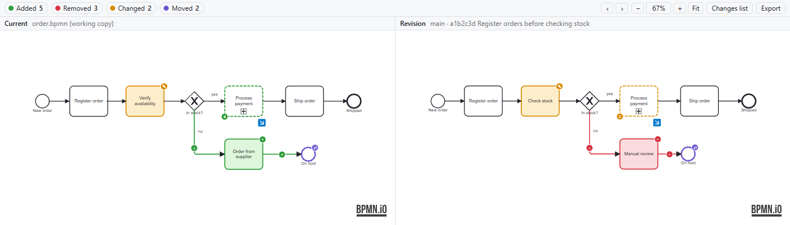
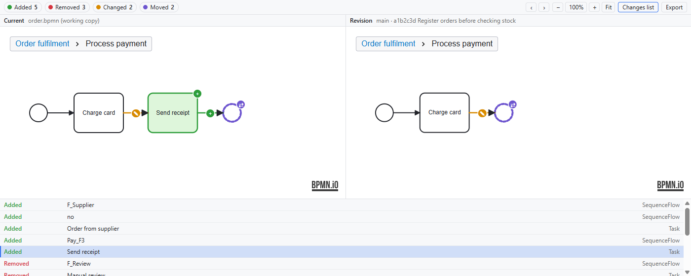

# BPMN Compare – IntelliJ IDEA plugin

[](https://github.com/petrsochan/idea-bpmn-compare/actions/workflows/build.yml)
[](https://github.com/petrsochan/idea-bpmn-compare/releases/latest)
[](https://securityscorecards.dev/viewer/?uri=github.com/petrsochan/idea-bpmn-compare)

Visual comparison of BPMN diagrams with any Git revision, powered by [bpmn.io](https://bpmn.io)
(`bpmn-js` for rendering, `bpmn-js-differ` for computing the differences).



- **Left:** the current content of the file (including unsaved changes, refreshed while you edit).
- **Right:** the same file from a chosen branch (local/remote), tag, commit that changed the file,
  or any revision expression (`HEAD~3`, a hash, …). A renamed or moved file is followed to its earlier
  names, both in the list of commits and when reading an older revision.
- Highlighting: 🟢 added (left), 🔴 removed (right), 🟠 changed attributes, 🟣 moved (layout change).
  The Added / Removed / Changed / Moved chips in the top bar work as a filter – click one to hide that kind
  of change from the diagrams and the change list (counts stay visible, the selection is remembered).
  The badge on an element has a tooltip with details; the *Changes list* button shows all changes –
  click an entry to center the element.
- **Moved means moved** – a shape, label or bend point shifted by at most 5 px is not reported, so a modeller
  that rounds coordinates or re-places labels when it saves does not mark half the diagram as moved.
  A changed number of bend points or an expanded/collapsed subprocess is always reported.
- **Camunda / Zeebe extensions** are compared too – execution listeners, input/output mappings, form fields,
  `zeebe:taskDefinition`. `bpmn-js-differ` ignores `extensionElements`, so an edit touching only a Camunda
  listener would otherwise show no change at all.
- **Collapsed subprocesses** – a collapsed subprocess with changes inside gets a dashed outline and a badge
  counting them, both in the colour of the most important kind of change inside. Stepping to
  such a change opens the subprocess, and while synchronized both diagrams drill in and out together.
  The SVG/PNG export contains the level of the diagram currently shown.

  
- **F7 / Shift+F7** step through the visible changes (wrapping around, skipping kinds hidden by a chip);
  the same two buttons are in the top bar, and Escape closes the change list.
- **Element history** – right-click an element in either diagram → *History of "…"*: the commits that changed
  it, with author, date, message and what happened to it (`Changed: name: "Check stock" → "Verify availability"`,
  `Moved`, …). Click one to open that commit's BPMN diff, centred on the element. Each commit is compared with its
  first parent by the same differ as the view – layout tolerance and Camunda/Zeebe extensions included – so a commit
  is listed exactly when its diff shows the element changed. The history follows renames of the file and reads the
  same 300 commits as the revision chooser.
- **Merge conflicts** – the IDE's merge window of a `.bpmn` file shows, above the unchanged text merge, the
  diagrams of ours, the result and theirs (the base behind a switch in the middle). Each side's changes against
  the base are highlighted; elements both sides changed are outlined in every diagram – loudly while the
  conflict is open – and listed first, with a *Conflicts* chip counting the open ones. The result diagram follows
  every Accept, Apply and edit and shows which side each change was taken from. F7, a click on an element or on
  a change-list row puts the result column's caret on that element, and moving the caret there selects the element
  in the diagrams. *Export* copies the change list of the merge as Markdown. Resolving stays in the text merge; *Show BPMN Diagrams* in its toolbar hides the diagrams (remembered).
  The diagrams help with merging smaller changes – a few renamed, moved or added elements; they make no claim to
  untangle complex merges, where the text merge remains the tool.
- **Conflict in the BPMN Diff tab** – while the file is in conflict (after a merge or rebase on the command line,
  or with the merge window closed unresolved), the tab shows ours | base | theirs from the Git index with the same
  highlights, and **Resolve…** opens the merge window. Once the conflict is gone the tab compares with the revision
  again.
- **Diagram ↔ XML** – double-click an element to open the XML editor on it; **Follow caret** (off by default)
  does the reverse and selects the element the caret is in.
- **Export** – the change list as Markdown into the clipboard, or the left diagram as SVG/PNG with the markers.
- **Synchronize mouse & view** – mirrors the cursor (a blue "ghost" cursor in the other diagram), hover and
  pan/zoom. The setting is remembered.
- The compared revision reloads by itself after a commit, checkout, fetch or rebase.

## Usage
Open a `.bpmn` file and switch to the **BPMN Diff** tab at the bottom of the editor,
or right-click the file → **Compare BPMN with Branch or Commit…**.

Any IDE diff of a `.bpmn` file can be switched to the BPMN view as well – open a diff from the commit dialog,
the Git log, *Compare with Branch…* or *Compare Two Files*, and pick **BPMN diagram** in the diff tool selector.
The IDE remembers the choice for each kind of diff window (commit dialog, Git log, …), so after picking it once
there, `.bpmn` files open in the BPMN view straight away – until you switch back to a text diff.
That is also the way to compare two revisions with each other; the editor tab always has the working copy on the left.

## Build
Requires JDK 21+ and Node.js (npm) – the web part in `webview/` is bundled with esbuild automatically during the build.

```
./gradlew runIde        # sandbox IDE with the plugin
./gradlew buildPlugin   # build/distributions/idea-bpmn-compare-*.zip → Settings | Plugins | Install Plugin from Disk
```

By default IntelliJ IDEA `platformVersion` from `gradle.properties` is downloaded. To build against a locally
installed IDEA instead (no download), set its path in `~/.gradle/gradle.properties`:

```
localIdePath=C:/Program Files/JetBrains/IntelliJ IDEA 2026.2
```

Every push to `main` and every pull request is built by GitHub Actions (`.github/workflows/build.yml`);
the plugin ZIP is attached to the workflow run as an artifact.

### Security and dependency automation
- **Build** (`build.yml`) also runs weekly and audits the bundled npm dependencies (`npm audit --omit=dev`).
- **Dependabot** (`.github/dependabot.yml`) – weekly updates of npm, Gradle (incl. the wrapper) and actions;
  security updates come immediately. Patch/minor updates are merged automatically once the checks pass
  (`dependabot-automerge.yml`) – except `bpmn-js` and `bpmn-js-differ`, which always wait for a manual review.
- **IntelliJ Platform** (`update-platform.yml`) – Dependabot cannot read `platformVersion`, so a weekly job
  opens a PR when a newer IntelliJ IDEA is released. Never merged automatically.
- **Dependency review** (`dependency-review.yml`) – fails a PR that brings in a dependency with a known
  high/critical vulnerability.
- **CodeQL** (default setup in the repository settings) – Java, JavaScript and the workflows themselves.
- **OpenSSF Scorecard** (`scorecard.yml`) – weekly supply-chain audit, results in *Security › Code scanning*.
- **Ruleset on `main`** – *Build plugin*, *Dependency review* and CodeQL must pass; repository admins may bypass
  it, so direct pushes to `main` still work.
- Actions are pinned to commit SHAs (Dependabot updates them); the Gradle distribution is pinned by checksum.

### Releasing
1. Move the `[Unreleased]` entries in `CHANGELOG.md` under `## [X.Y.Z]` and set `pluginVersion=X.Y.Z`
   in `gradle.properties`; merge that to `main`.
2. Tag the release commit and push the tag:
   ```
   git tag vX.Y.Z && git push origin vX.Y.Z
   ```
3. `release.yml` checks that the tag matches `pluginVersion` and is on `main`, builds and verifies the plugin,
   and publishes a GitHub Release with the ZIP, the changelog section as notes, its SHA-256 and a build
   provenance attestation, attached as `<zip>.intoto.jsonl` too. Verify a downloaded ZIP with
   `gh attestation verify <zip> --repo petrsochan/idea-bpmn-compare` (add `--bundle <zip>.intoto.jsonl`
   to verify against the attached file instead of the GitHub API).
4. The *Publish to JetBrains Marketplace* job then waits for your approval (*Actions › the run › Review
   deployments*). Once approved it verifies the attestation of the released ZIP and uploads that exact file to
   [JetBrains Marketplace](https://plugins.jetbrains.com/plugin/34425-bpmn-compare), where it goes through
   JetBrains' review. The upload token is the `PUBLISH_TOKEN` secret of the `marketplace` environment
   (a permanent token from plugins.jetbrains.com › *My Tokens*), usable only from `v*` tags.

Running *Release* manually (*Actions › Release › Run workflow*) with an existing tag is a dry run: it does
everything except publishing and attaches the ZIP and the notes to the run.

Target: IntelliJ IDEA 2026.2+ (build 262) – in this version JCEF and DVCS are separate platform modules.
Those IDEs run on JBR 21, so the plugin is compiled to Java 21 bytecode. Earlier IDEs are not supported;
compatibility is checked by the IntelliJ Plugin Verifier (`./gradlew verifyPlugin`) as part of the build.

## Structure
`src/main/java/com/github/bpmncompare/`
- `BpmnCompareEditorProvider`, `BpmnCompareEditor` – the **BPMN Diff** editor tab
- `BpmnDiffTool`, `BpmnDiffViewer` – the same view as a tool in the IDE's own diff windows
- `BpmnComparePanel` – toolbar, JCEF browser and the bridge in both directions
- `BpmnContentSource` – where a pane's content comes from: working copy, Git revision, or text from the platform
- `DiagramSide` – what a pane shows, and its JSON shape for the page
- `GitRevisions`, `GitLogParser` – Git access and parsing of the revision chooser entries
- `BpmnXmlLocator` – element id ↔ offset in the XML, for navigating between diagram and editor
- `GoToChangeAction` – the F7 / Shift+F7 actions
- `ElementHistory` – the element history: reads Git, has the page decide which commits touched the element,
  shows the popup and opens the commit diff
- `Json` – the minimal JSON written to and read from the page

`webview/src/` – page with two `NavigatedViewer`s. `main.js` wires the parts together, renders what the
host sends and answers its calls. The parts that work with the page: `panes.js` (the two viewers),
`sync.js` (viewport, plane, hover and cursor synchronization), `decorations.js` (markers and badges),
`navigation.js` (F7 stepping, centring), `zoom.js`, `filter.js` (filter chips), `change-list.js` (counts
and the side list), `export-menu.js`, `element-menu.js` (right-click menu, history), `tooltips.js`,
`host.js` (messages to the IDE). The pure modules they are built from: `changes.js` (change list),
`extensions.js` (Camunda/Zeebe extension elements), `layout.js` (tolerance for tiny layout shifts),
`format.js` (names and values), `export.js` (Markdown, SVG, PNG), `planes.js` (changes hidden in
collapsed subprocesses), `history.js` (what one commit did to one element).

`docs/screenshots/` holds the two versions of the sample diagram the pictures in `docs/images/` are taken from:
build the web view, serve `build/generated/webview/bpmn-compare` together with both files, and pass them to
`window.bpmnCompare.setDiagrams({ left: { xml, label }, right: { xml, label } })` in a browser.

Tests: `src/test/java/…` (JUnit), `webview/test/` (`node:test`, the pure modules) and `webview/e2e/`
(Playwright in Chromium, the built page with two test diagrams: rendering, synchronization, subprocess
planes, F7, filters, menus and the messages to the IDE). All of them run in `./gradlew check`; the browser
tests alone with `npm run e2e` in `webview/` (after a one-time `npx playwright install chromium`).

### Things that look wrong but are not
- **The page draws its own tooltips** (`data-tip` plus `tooltips.js`), and uses no
  `title` attribute. Inside JCEF a native tooltip is handed to the client through
  `CefDisplayHandler#onTooltip`, which `JBCefClient` only forwards to display handlers a plugin
  registers – so a `title` is silently swallowed and nothing is ever shown.
- **Inactive top bar buttons use `aria-disabled`, not `disabled`.** A disabled button receives no
  pointer events, so it could not be hovered to explain why it does nothing.
- **`normalizeAttrs` swaps the differ's old and new values** on purpose: `bpmn-js-differ` walks from
  the current file to the revision, so its `oldValue` is our new one. `webview/test/format.test.js`
  pins this down.

## License
The plugin is licensed under the [MIT License](LICENSE). The `LICENSE` file is included in the root of the plugin
ZIP and in `META-INF` of the plugin jar.

## Third-party licenses
The web part bundles [bpmn-js](https://github.com/bpmn-io/bpmn-js) (© Camunda Services GmbH, bpmn.io license),
[bpmn-js-differ](https://github.com/bpmn-io/bpmn-js-differ) (MIT) and their dependencies (MIT / ISC).

- The build (`webview/build.mjs`) generates `THIRD-PARTY-NOTICES.txt` with the copyright and full license text
  of every package that actually ends up in the bundle. The file is in the root of the plugin ZIP and in the jar
  next to the bundle, and the headers of `bundle.js`/`bundle.css` refer to it. A bundled package without
  a license file fails the build.
- The bpmn.io license requires the "bpmn.io" watermark in the diagram to stay **unchanged and fully visible**
  and not overlapped by other elements – `.bjs-powered-by` must therefore never be restyled or hidden.
  Links from the watermark open in the system browser.
